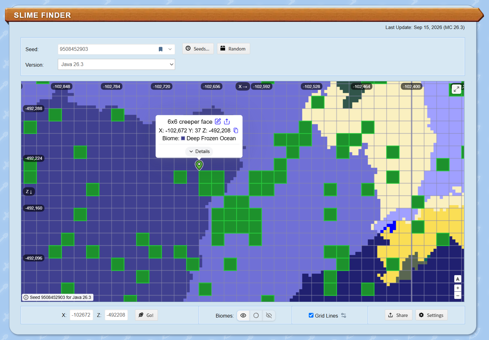
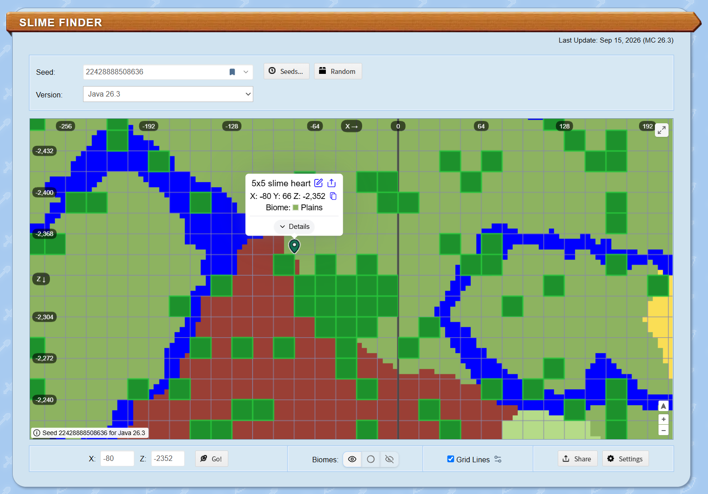

# 如何快速寻找史莱姆区块？

在 Minecraft 中，$xz$ 平面上每 $16 \times 16$ 个方块的区域被称为一个区块。有一些区块在 $y<40$ 的地方可以自然生成史莱姆，被称为史莱姆区块。

史莱姆区块是史莱姆农场的基础。为了效率最大化，史莱姆农场往往会在史莱姆区块密集的地方选址。例如 $3 \times 3$、$4 \times 4$ 甚至 $5 \times 5$ 的相邻史莱姆区块。此外还有人想要寻找特定图案的史莱姆区块。

本文主要介绍 Java 版史莱姆区块的生成规律和如何快速寻找特定图案的史莱姆区块。

:::note[应用案例：苦力怕脸史莱姆区块]



:::

:::note[应用案例：5×5 史莱姆区块]


:::

:::note[应用案例：心形史莱姆区块]



:::

## 史莱姆区块的判定

### 史莱姆公式

史莱姆区块的判定由**世界种子** $w$ 和**区块坐标** $(x,z)$ 共同决定，相同的种子与坐标总是会得到相同的结果：先计算坐标项 $T(x,z)$，与世界种子组合后初始化 `Random`，再调用 `nextInt(10)`。**返回 0 就是史莱姆区块，返回 1 到 9 则不是**。也就是说，史莱姆区块的概率是 $1/10$。

```java
import java.util.Random;

boolean isSlimeChunk(long worldSeed, int x, int z) {
    return new Random(
        worldSeed
        + (int) (x * x * 4987142)
        + (int) (x * 5947611)
        + (int) (z * z) * 4392871L
        + (int) (z * 389711)
        ^ 987234911L
    ).nextInt(10) == 0;
}
```

先用一个记号表示 Java 有符号 32 位整数的溢出处理：保留运算结果的低 32 位，再按有符号数解释。本文的 `mod` 一律取非负余数。

$$
J_{32}(\xi)=((\xi+2^{31})\bmod2^{32})-2^{31}.
$$

原始坐标项是：

$$
T(x,z)=J_{32}(4987142x^2)+J_{32}(5947611x)
       +4392871J_{32}(z^2)+J_{32}(389711z).
$$

:::note[应用案例：整数溢出]

$x=51069$ 的第一项在不考虑溢出时为 $4987142\times51069^2=13006679591179062$。按 Java 的 32 位整数计算，结果是 $J_{32}(13006679591179062)=-1799531722$。这个溢出后的结果才参与后面的坐标项求和。

:::

随机数种子的公式：

$$
(w+T(x,z)) \mathbin{\mathrm{xor}} 987234911.
$$

### Random 的内部实现

下面的函数等价于 `new Random(randomSeed).nextInt(10)`：
初始化得到 48 位状态 $u$；每次乘 $A$、加 11、保留低 48 位得到 $v$，再取高 31 位得到 $q$。通常返回 `q % 10`；若 `q - value + 9` 超过有符号 32 位整数的上限，就从当前状态继续重抽。

```java
int nextInt10(long randomSeed) {
    final long A = 0x5DEECE66DL;
    final long mask48 = (1L << 48) - 1;
    long u = (randomSeed ^ A) & mask48;

    while (true) {
        long v = (A * u + 11) & mask48;
        int q = (int) (v >>> 17);
        int value = q % 10;
        if ((long) q - value + 9 <= 0x7FFFFFFFL) {
            return value;
        }
        u = v;
    }
}
```

合并史莱姆公式和 Random 初始化里的两次 XOR：

$$
A=\mathtt{0x5DEECE66D},\qquad
C=A\mathbin{\mathrm{xor}}987234911=\mathtt{0x5E434E432}.
$$

对单个区块 $(x,z)$，首次输出由三步得到：

$$
u=((w+T(x,z))\mathbin{\mathrm{xor}}C)\bmod2^{48},
$$
$$
v=(Au+11)\bmod2^{48},
$$
$$
q=v\gg17.
$$

如果首次输出被接受，`nextInt(10)` 返回 $q\bmod10$；返回 0 表示史莱姆区块。因此首次输出分支的候选条件是 $q\equiv0\pmod{10}$。

## 朴素的爆搜

我们暂时把 Random 的数学性质按下不表，基于上面的公式，采用朴素的手段进行爆搜。

### CPU：按种子枚举位置

最直接的方法是枚举世界种子和区块坐标，调用上面的判定函数。要找一片全部满足要求的区域，就检查该位置及其周围各格；只要一格失败，这个候选便可提前退出：

```python
for worldSeed in seeds:
    for (x, z) in positions:
        allSlime = True
        for (dx, dz) in offsets:
            if not isSlimeChunk(worldSeed, x + dx, z + dz):
                allSlime = False
                break
        if allSlime:
            record(worldSeed, x, z)
```

:::note

从这一节开始，会有一些实测数据。所有测试都在作者的同一台笔记本上进行，CPU 为 AMD Ryzen 7 5800H，GPU 为 NVIDIA GeForce RTX 3060 Laptop GPU。并非严谨测试，数据仅供参考。

:::

### CUDA：每个线程负责一个种子

同样的逻辑可以在 GPU 上实现。每个线程负责一个世界种子，扫描全部候选位置：

```text
GPU thread(worldSeed):
    for (x, z) in positions:
        check and record this candidate
```

:::note[实测对照：CPU 与按种子分工的 CUDA]

同样搜索 65536 个种子、257×257 个候选位置，目标都是实心 5×5。

| 版本 | 搜索时间中位数 |
| --- | ---: |
| CPU，16 个逻辑线程 | 3550.398 ms |
| CUDA，每线程一个种子 | 111.110 ms |

约加速 31.95 倍。CPU 时间包含线程创建、搜索与结果收集；GPU 使用 scan 时间，含清零、同步及回传，不含一次性的上下文创建和显存分配。

:::

### CUDA：固定坐标，在线程内遍历种子

还可以交换两层循环的分工：让一个工作单元固定一个坐标，在线程内部遍历种子。

```text
之前：thread(worldSeed) -> 扫描全部坐标
之后：thread(x, z)      -> 遍历全部种子
```

交换循环后，每个位置的坐标项 $T(x,z)$ 只需计算一次；遍历种子时，只改变与它相加的 $w$，就能省去重复的乘法计算。

:::note[实测对照：在更大的地图上比较两种分工]

同样搜索 65536 个种子、4097×4097 个位置、实心 5×5：

| 版本 | GPU kernel 时间中位数 |
| --- | ---: |
| 每线程一个种子 | 31598.539 ms |
| 固定坐标并复用轴项 | 17600.387 ms |

约加速 1.795 倍。

:::

### Outer Sum：相邻线程共享坐标轴项

这里还有一个优化点：相邻位置需要的 X、Z 坐标大量重叠，可以将坐标项按变量拆开：

$$
F(x)=J_{32}(4987142x^2)+J_{32}(5947611x),
$$

$$
G(z)=4392871J_{32}(z^2)+J_{32}(389711z),
$$

$$
T(x,z)=F(x)+G(z).
$$

$F$ 只依赖 X，$G$ 只依赖 Z，把所有 X 项排成一列、Z 项排成一行，每个交点就是对应两项之和。例如取三个 X 坐标和三个 Z 坐标，坐标项表就是：

| X 轴项 ＼ Z 轴项 | $G(z)$ | $G(z+1)$ | $G(z+2)$ |
| --- | --- | --- | --- |
| $F(x)$ | $F(x)+G(z)$ | $F(x)+G(z+1)$ | $F(x)+G(z+2)$ |
| $F(x+1)$ | $F(x+1)+G(z)$ | $F(x+1)+G(z+1)$ | $F(x+1)+G(z+2)$ |
| $F(x+2)$ | $F(x+2)+G(z)$ | $F(x+2)+G(z+1)$ | $F(x+2)+G(z+2)$ |

表中每格都是对应坐标的 $T$，例如第二行、第三列为 $T(x+1,z+2)$。同一行复用一个 $F$，同一列复用一个 $G$：只需计算 3 个 X 轴项和 3 个 Z 轴项，就能通过 9 次加法组成 9 个坐标项。一般地，$a$ 个 X 坐标和 $b$ 个 Z 坐标，只需计算 $a+b$ 个轴项，再按需相加得到 $ab$ 个坐标项。

:::note[Outer Sum]

类比 outer product，这种“每个横轴项加上每个纵轴项”就是 outer sum：

$$
\bm{\alpha}\boxplus\bm{\beta}=(\alpha_i+\beta_j)_{m\times n}=\begin{pmatrix}
\alpha_0+\beta_0 & \alpha_0+\beta_1 & \cdots & \alpha_0+\beta_{n-1} \\
\alpha_1+\beta_0 & \alpha_1+\beta_1 & \cdots & \alpha_1+\beta_{n-1} \\
\vdots & \vdots & \ddots & \vdots \\
\alpha_{m-1}+\beta_0 & \alpha_{m-1}+\beta_1 & \cdots & \alpha_{m-1}+\beta_{n-1}
\end{pmatrix}
$$

:::

利用这个数学性质，可以减少重复计算，让相邻线程共享各轴的计算结果。

:::note[实测对照：线程私有轴项与 block 共享轴项]

本组将种子数量设为 1，扫描 32769×32769 个位置，共 1,073,807,361 个候选，目标仍为实心 5×5：

| 版本 | GPU kernel 时间中位数 |
| --- | ---: |
| 线程私有轴项 | 40.350 ms |
| outer sum 共享轴项 | 23.767 ms |

约加速 1.698 倍。

:::

## Random 的数学性质

### 随机数重试

#### 拒绝采样的原因

`nextInt(10)` 不能直接把 `next(31)` 的结果对 10 取模，因为 $2^{31}$ 不是 10 的整数倍：

$$
2^{31}=10\times214748364+8.
$$

在 $0,\ldots,2^{31}-1$ 中，余数 0 到 7 各出现 $214748365$ 次，而余数 8 和 9 各出现 $214748364$ 次。直接取模会让前八个结果略微偏多。为消除这种取模偏差，Java 会拒绝末尾多出来的 8 个数，再从当前状态继续生成下一个数。这就是[官方文档中 `nextInt` 的拒绝采样](https://docs.oracle.com/en/java/javase/17/docs/api/java.base/java/util/Random.html#nextInt(int))。

因此，前面代码中的溢出检查，等价于判断 $q$ 是否落入拒绝区间：

$$
q\in[2147483640,2147483647]=[2^{31}-8,2^{31}-1].
$$

接受区间 $[0,2147483639]$ 的长度恰好是 10 的整数倍，每种余数出现的次数相同。

#### 随机数重试的次数

一般的 `nextInt(bound)` 可能连续拒绝，但对于 `bound = 10`，**连续两次拒绝不可能发生**，这可以通过计算状态的下一状态来验证。

令 $M=2^{48}$。由于 $q=v\gg17$，首次被拒绝时，内部状态必定满足：

$$
v\in[M-8\cdot2^{17},M-1]=[M-2^{20},M-1].
$$

这个区间只有 $2^{20}=1,048,576$ 个状态。对它们逐一计算下一状态 $v'=(Av+11)\bmod M$，可以用下面这段 Python 做完整验证：

```python
A = 0x5DEECE66D
M = 1 << 48
reject_start = M - (1 << 20)
max_next = max((A * v + 11) % M for v in range(reject_start, M))
assert max_next == 281474868936375
assert max_next < reject_start  # 下一状态全部落在接受区间
```

也就是说，重抽得到的 $q'=v'\gg17$ 最大为 $2147482825$，仍小于拒绝区间的起点 $2147483640$，所以一定被接受。于是本文的 `nextInt(10)` 最多生成两个 31 位数：首次生成，加上至多一次重试。实现时可以把重试循环改成一次条件分支。

#### 触发重试的概率

固定区块坐标，让世界种子的低 48 位均匀取值。加上坐标项、与常量 XOR 都是一一映射；由于 $A$ 是奇数，$u\mapsto(Au+11)\bmod2^{48}$ 也是一一映射。因此首次状态 $v$ 均匀遍历全部 48 位取值，$q=v\gg17$ 均匀遍历全部 31 位取值，得到：

$$
P(\text{重试})=\frac{8}{2^{31}}=2^{-28}
\approx3.72529\times10^{-9}.
$$

也就是平均每 268,435,456 次区块判定触发一次。概率虽小，精确搜索仍需处理这一分支：例如首次 $q=2147483640$ 虽然能被 10 整除，却必须拒绝，是否为史莱姆区块要看重抽结果。

#### 本文后续算法的局限性

在后续的数学性质分析中，我们只考虑首次输出的情况。这会造成两种情况：

- **误报（false positive）**：首次输出落入拒绝区间，且能被 10 整除，但重抽结果不能被 10 整除。只检查首次输出会将它误判为史莱姆区块。
  - 这个问题很容易解决：在搜索到候选后，用完整的算法验证一次，即可排除误判。
- **漏报（false negative）**：首次输出落入拒绝区间，且不能被 10 整除，但重抽结果能被 10 整除。只检查首次输出会漏掉这个史莱姆区块。
  - 这个问题很难解决：要考虑重抽的情况，必须在搜索算法里增加一个判断和分支，这会显著降低算法的性能。

不过考虑到概率极小，漏掉的史莱姆区块数量很少。后文的算法都是基于首次输出的情况，辅以完整验证来排除误报。

### 世界种子的 48 位等价关系

我们回顾一下史莱姆公式。对单个区块 $(x,z)$，首次输出由三步得到：

$$
u=((w+T(x,z))\mathbin{\mathrm{xor}}C)\bmod2^{48},
$$
$$
v=(Au+11)\bmod2^{48},
$$
$$
q=v\gg17.
$$

可以看到，Random 初始化只保留低 48 位。世界种子相差 $2^{48}$ 的整数倍，在相同坐标上就得到相同的完整 Random 序列。因此可以先搜索 $w\in[0,2^{48})$；一个 $w$ 对应 64 位世界种子的 $2^{16}$ 种高位取值。

## 反推种子算法

在固定坐标的情况下，要想寻找到满足条件的世界种子，最直接的办法是枚举所有可能的 $w$，计算 $q$，检查是否满足条件。

然而，种子的取值范围很大，直接枚举所有可能的种子效率很低。我们可以利用数学性质，先缩小搜索范围，再反推世界种子。

### 有效种子归一化和拆分

#### 从有效种子反推世界种子

在史莱姆公式中，世界种子与坐标项总是以 $w+T(x,z)$ 的形式出现。把这个和记为**有效种子**：

$$
s=(w+T(x,z))\bmod2^{48}.
$$

于是初始化状态可以直接写成：

$$
u=(s\mathbin{\mathrm{xor}}C)\bmod2^{48}.
$$

对固定坐标，$T(x,z)$ 已知。我们可以先寻找满足输出条件的 $s$，再反推世界种子：

$$
w=(s-T(x,z))\bmod2^{48}.
$$

#### 从单个区块扩展到窗口

现在考虑一个窗口，要求其中各格都是史莱姆区块。选一格作为锚点，编号为 0，坐标记为 $(x,z)$，用它的坐标项定义 $s$。其余各格用相对锚点的偏移 $(\alpha_i,\beta_i)$ 表示，第 $i$ 格的坐标为 $(x+\alpha_i,z+\beta_i)$；锚点自身的偏移为 $(\alpha_0,\beta_0)=(0,0)$。

:::note[应用案例：固定一个实心 5×5 窗口]

后续推导统一以锚点 $(51069,419124)$ 的实心 5×5 窗口为例：$x=51069,\ldots,51073$，$z=419124,\ldots,419128$，要求全部 25 格都是史莱姆区块。这里取最小 X、最小 Z 的格子为锚点，按 X 方向先编号：$i=5\beta_i+\alpha_i$，其中 $\alpha_i,\beta_i\in\{0,1,2,3,4\}$。

| $z\backslash x$ | 51069 | 51070 | 51071 | 51072 | 51073 |
| --- | ---: | ---: | ---: | ---: | ---: |
| 419124 | （锚点）0 | 1 | 2 | 3 | 4 |
| 419125 | 5 | 6 | 7 | 8 | 9 |
| 419126 | 10 | 11 | 12 | 13 | 14 |
| 419127 | 15 | 16 | 17 | 18 | 19 |
| 419128 | 20 | 21 | 22 | 23 | 24 |

:::

:::note[应用案例：6×6 苦力怕脸]

窗口不一定是实心的方阵，也可以是任意的图案。下面是一个 6×6 苦力怕脸的例子。
取左上角为锚点，$\alpha$ 向右增加，$\beta$ 向下增加。要求为史莱姆区块的 20 格用编号 $i$ 标出：

| $\beta\backslash\alpha$ | 0 | 1 | 2 | 3 | 4 | 5 |
| --- | ---: | ---: | ---: | ---: | ---: | ---: |
| 0 | 0 | 1 | · | · | 2 | 3 |
| 1 | 4 | 5 | · | · | 6 | 7 |
| 2 | · | · | 8 | 9 | · | · |
| 3 | · | 10 | 11 | 12 | 13 | · |
| 4 | · | 14 | 15 | 16 | 17 | · |
| 5 | · | 18 | · | · | 19 | · |

第 $i$ 格所在的列就是 $\alpha_i$，所在的行就是 $\beta_i$。
值得注意的是，这样的条件筛出苦力怕脸总是上头朝北的。如果需要其它朝向的，需要用旋转后的图案重新搜索。
后面的搜索算法只确保编号格是史莱姆区块，`·` 处的则可以是也可以不是。若还要求 `·` 处都一定不是史莱姆区块，在最后验证时补查即可。由于筛选剩下的种子很少，而一个区块不是史莱姆区块的概率很高，这样的做法不会带来很大的额外开销，但却能简化搜索算法，提高搜索效率。

:::

#### 各格相对锚点的坐标项

窗口内各格共享同一个 $w$，但坐标项不同。既然 $s$ 已经吸收了锚点的坐标项，计算其他格子时，只需再补上“该格坐标项减去锚点坐标项”的差。把这个差记为 $d_i$，称为**相对坐标项**。

第 $i$ 格的坐标项 $T(x+\alpha_i,z+\beta_i)$ 记为 $T_i$，锚点的坐标项就是 $T_0$。这样：

$$
s=(w+T_0)\bmod2^{48},\qquad d_i=(T_i-T_0)\bmod2^{48}.
$$

锚点满足 $d_0=0$，各格则满足：

$$
w+T_i\equiv s+d_i\pmod{2^{48}}.
$$

给状态和输出也加上格子下标后，每格统一按以下公式计算：

$$
u_i=((s+d_i)\mathbin{\mathrm{xor}}C)\bmod2^{48},
$$

$$
v_i=(Au_i+11)\bmod2^{48},\qquad q_i=v_i\gg17.
$$

搜索目标就是找到同一个 $s$，让窗口内所有格子都满足首次输出条件。求到后仍按原来的逆变换恢复：

$$
w=(s-T_0)\bmod2^{48}.
$$

这就是以锚点为基准的**有效种子归一化**。它也让不同位置的低位条件可以按坐标类复用。

:::note[应用案例：前两格的坐标项]

将锚点和右邻格坐标代入，得到：

$$
T_0=T(51069,419124)=-1883366190470623,
$$

$$
T_1=T(51070,419124)=-1883363608967202.
$$

后面所有相对坐标项都从同一组 25 个 $T_i$ 计算。

:::

:::note[应用案例：把锚点吸收到有效种子里]

由上面的坐标项：

$$
s=(w-1883366190470623)\bmod2^{48},
$$

$$
d_0=0,\qquad d_1=T_1-T_0=2581503421.
$$

因而右邻格统一从 $s+2581503421$ 初始化。现在 $w$、$s$ 都还未知，下一步先求 $s$ 的低 18 位。

:::

#### 有效种子的拆分

把待求的有效种子拆成：

```text
高 13 位 h | 中间 17 位 m | 低 18 位 p
```

$$
s=p+2^{18}m+2^{35}h,
$$

$$
0\le p<2^{18},\quad0\le m<2^{17},\quad0\le h<2^{13}.
$$

### 低 18 位的奇偶筛选

#### 基于输出奇偶的低 18 位筛选

一个数能被 10 整除，必须先是偶数。$q_i=v_i\gg17$，所以 $q_i$ 的最低位就是 $v_i$ 的第 17 位，位编号从 0 开始。

加法、乘法和逐位 XOR 的低 18 位只依赖输入的低 18 位，高位不会反过来影响低位。因此只用 $p$ 就能判断所有格子的首次输出奇偶：计算状态的低 18 位，并要求每格都满足下面的条件：

$$
[A((p+d_i)\mathbin{\mathrm{xor}}C)+11]\bmod2^{18}<2^{17}.
$$

小于 $2^{17}$ 就表示第 17 位为 0。某格不满足，该 $p$ 对应的全部中间位、高位都可以直接排除。

实际执行时枚举 $p=0,1,\ldots,262143$，通过所有格子的 $p$ 保存为**低位根**。后续简称为根。

:::note[应用案例：5×5 窗口的低 18 位候选数量]

锚点 $(51069,419124)$ 的实心 5×5 窗口，最后保留 **84 个低位根**，约占原来 262144 个取值的 0.032%。

后面跟随其中的 $p=218767$。代入筛选式，前两格的状态低 18 位分别是 59524、80305，都小于 $2^{17}=131072$；其余 23 格也通过。

:::

#### 坐标类周期与低位根复用

对固定窗口形状，各格的偏移 $(\alpha_i,\beta_i)$ 固定。由坐标项的可分离性：

$$
d_i=F(x+\alpha_i)-F(x)+G(z+\beta_i)-G(z)\pmod{2^{48}}.
$$

低位筛选只看 $d_i\bmod2^{18}$。Java 整数溢出后保留低 32 位，符号扩展也不会改变低 18 位，所以推导这部分时可以直接在模 $2^{18}$ 下展开多项式：

$$
\begin{aligned}
d_i\equiv{}&4987142(2x\alpha_i+\alpha_i^2)+5947611\alpha_i\\
&+4392871(2z\beta_i+\beta_i^2)+389711\beta_i\pmod{2^{18}}.
\end{aligned}
$$

将锚点 X 增加 $2^{16}=65536$，相对项的变化为：

$$
2\cdot4987142\cdot2^{16}\alpha_i.
$$

4987142 是偶数，所以变化是 $2^{18}$ 的整数倍。将 Z 增加 $2^{17}=131072$，变化为：

$$
2\cdot4392871\cdot2^{17}\beta_i,
$$

也必然是 $2^{18}$ 的整数倍。因此可用：

$$
(x\bmod65536,\ z\bmod131072)
$$

作为坐标类。同类位置所有 $d_i$ 的低 18 位相同，**有效种子的完整低位根列表也相同**。

程序为每个未缓存的类筛一次根。后续筛选具体位置时，若该坐标类没有低位根，就跳过该位置；否则生成后续任务。

#### 中间 17 位的枚举

上一步保证首次输出都是偶数，还没有保证能被 5 整除。

这里我们继续进行一次拆分，记：

$$
\ell=p+2^{18}m,\qquad s=\ell+2^{35}h.
$$

每根仍有 $2^{17}=131072$ 种中间位 $m$，随后继续筛选和求解。

:::note[应用案例：5×5 窗口的低 35 位候选数量]

每根补上全部中间位后，一共需要考虑：

$$
84\times131072=11010048
$$

种低 35 位取值。

:::

### 利用输出差筛选低 35 位

#### 高 13 位引起的输出共同平移

上一节之所以选择在第 35 位拆分，是因为 $C<2^{35}$，所以在准备初始状态时，XOR 只翻转低 35 位，高 13 位不变。

因此我们可以固定低 35 位 $\ell=p+2^{18}m$，把 $h$ 作为独立变量，用 $u_i(h)$、$v_i(h)$ 和 $q_i(h)$ 表示高位取 $h$ 时对应变量的值。

由于 XOR 不动这段高位，初始化状态满足：

$$
u_i(h)=(u_i(0)+2^{35}h)\bmod2^{48}.
$$

乘 $A$ 并加 11 后：

$$
\begin{aligned}
v_i(h)
&=(Au_i(h)+11)\bmod2^{48}\\
&=(Au_i(0)+Ah\,2^{35}+11)\bmod2^{48}.\\
&=((Au_i(0)+11)+Ah\,2^{35})\bmod2^{48}.\\
&=(v_i(0)+Ah\,2^{35})\bmod2^{48}.
\end{aligned}
$$

新增量是 $2^{35}$ 的整数倍，不会改变右移时丢掉的低 17 位，所以：

$$
q_i(h)=v_i(h)\gg 17=(q_i(0)+Ah\,2^{18})\bmod2^{31}.
$$

为方便起见，记 $\bar q_i=q_i(0)$，所以 $$q_i(h)=(\bar q_i+Ah\,2^{18})\bmod2^{31}.$$

改变 $h$ 时，所有格子的输出都在模 $2^{31}$ 下增加同一个量 $Ah\,2^{18}$，因此它们的输出会**共同平移**。

:::note[应用案例：同一窗口的共同平移]

后面会筛出 $p=218767,m=40302$。固定这两段时，前两格的基准输出为 $\bar q_0=227860608$、$\bar q_1=1920935636$。若高位取 $h=2995$，共同增量取模后为：

$$
Ah\,2^{18}\bmod2^{31}=886833152.
$$

因而 $q_0(h)=1114693760$，$q_1(h)=(1920935636+886833152)\bmod2^{31}=660285140$。

:::

#### 基于输出差的低 35 位过滤

各格的输出含有相同的增量，因此可以通过作差消去 $h$。定义：

$$
\delta_i=(\bar q_i-\bar q_0)\bmod2^{31}.
$$

如果存在某个高位 $h$，使两格最终输出都是 10 的倍数，那么它们的直接差也是 10 的倍数。若差非负，模差除以 10 余 0；若差为负，取模需要加上 $2^{31}$，而：

$$
2^{31}\bmod10=8.
$$

所以必要条件是：

$$
\delta_i\bmod10\in\{0,8\}.
$$

:::note[应用案例：右邻格的模输出差]

沿用上一节的 $p,m,h$，两格的实际输出差为负：

$$
q_1-q_0=660285140-1114693760=-454408620.
$$

加上 $2^{31}$ 后得到 $\delta_1=1693075028$，除以 10 余 8，因此通过差过滤。若反向相减，正差 $454408620$ 除以 10 余 0。

用基准输出计算也得到 $(1920935636-227860608)\bmod2^{31}=1693075028$。这正是“不必先知道 $h$，也能检查模差”的意义；其余 23 格仍要分别检查。

:::

模差的余数不属于 $\{0,8\}$，就可以断定**当前低 35 位无论怎样补高位都不会成功**。

:::note[应用案例：输出差过滤的幸存数量]

锚点 $(51069,419124)$ 的实心 5×5 窗口，在 11010048 种低 35 位中，只有 **36 种通过全部输出差条件**。

:::

#### 预计算与中间位无关的项

上述筛选方法需要遍历低 35 位，计算 $\bar q_i$。根的数量较少，但中间位的数量巨大。我们可以把与中间位无关的部分提前算好，后续直接复用，降低计算量。

固定位置和根 $p$，令：

$$
\sigma_i=p+d_i,\qquad \rho_i=\sigma_i\bmod2^{18},\qquad \mu_i=\lfloor \sigma_i/2^{18}\rfloor.
$$

加入中间位后，输入就是：

$$
\ell+d_i=\rho_i+2^{18}(\mu_i+m).
$$

令 $E=C\gg18=\mathtt{0x1790d}$。XOR 可按位拆开：

$$
(\ell+d_i)\mathbin{\mathrm{xor}}C
=(\rho_i\mathbin{\mathrm{xor}}(C\bmod2^{18}))
+2^{18}((\mu_i+m)\mathbin{\mathrm{xor}}E).
$$

把低位推进带来的贡献记为：

$$
\kappa_i=\left\lfloor\frac{A(\rho_i\mathbin{\mathrm{xor}}(C\bmod2^{18}))+11}{2^{17}}\right\rfloor.
$$

于是首次输出精确等于：

$$
\bar q_i(m)=[\kappa_i+2A((\mu_i+m)\mathbin{\mathrm{xor}}E)]\bmod2^{31}.
$$

$\mu_i,\kappa_i$ 会随位置和根改变，但不随中间位 $m$ 改变，每个 `(位置, 根)` 只需准备一次。它们被称为**公共项**。

:::note[应用案例：为根 $p=218767$ 准备公共项]

前两格的值为：

| 格子 $i$ | $d_i$ | $\rho_i$ | $\mu_i$ | $\kappa_i$ |
| --- | ---: | ---: | ---: | ---: |
| 0 | 0 | 218767 | 0 | 46624833586 |
| 1 | 2581503421 | 128076 | 9848 | 13419656886 |

这些值算一次即可用于这个根的全部中间位。代入 $m=40302$，有 $(40302\mathbin{\mathrm{xor}}96525)=124003$、$((9848+40302)\mathbin{\mathrm{xor}}96525)=113387$，从而：

$$
\bar q_0=[46624833586+2A\times124003]\bmod2^{31}=227860608,
$$

$$
\bar q_1=[13419656886+2A\times113387]\bmod2^{31}=1920935636.
$$

$\kappa_i$ 是中间贡献项，可以超过 $2^{31}$；最终的 $\bar q_i$ 才取模到 31 位输出范围内。

:::

### 中间位的成组筛选

上一节的预计算可以加快单个输出的计算，但如果逐个检查，仍需对每个 $m$ 计算各格与锚点的模输出差。

将中间位分成每组 16 个候选后，利用 XOR 常量中的连续零位，每格只需计算组首、组尾的模输出差，就能判断整组候选是否满足该格的输出差条件。将各格的允许掩码按位 AND，得到通过整个窗口筛选的候选。

#### 中间位分组规则

预计算后的输出公式为：

$$
\bar q_i(m)=[\kappa_i+2A((\mu_i+m)\mathbin{\mathrm{xor}}E)]\bmod2^{31}.
$$

其中 $\mu_i,\kappa_i$ 已经固定，每次只需重新计算 $(\mu_i+m)\mathbin{\mathrm{xor}}E$，再代入公式。$E=\mathtt{0x1790d}$ 的第 4～7 位恰好全是 0，位编号从 0 开始。让 $m$ 的这四位取遍 16 种组合，其余位固定：

$$
m_j=\mathrm{base}+16j,\qquad j=0,\ldots,15.
$$

$\mathrm{base}$ 是将第 4～7 位清零后的组首值。它的低四位和第 8～16 位可以任意选择，因此共有 $2^4\times2^9=8192$ 组，每组 16 个候选，恰好覆盖全部 $2^{17}$ 种中间位。用组号 $g$ 枚举时：

$$
\mathrm{base}=256\lfloor g/16\rfloor+(g\bmod16),\qquad g=0,\ldots,8191.
$$

:::note[应用案例：包含 $m=40302$ 的那一组]

固定根仍为 $p=218767$。取 $g=2526$，得到 $\mathrm{base}=40206$，整组为：

$$
m_j=40206+16j=40206,40222,\ldots,40446.
$$

其中 $j=6$ 对应 $m=40302$。这一组的低四位都为 14，第 4～7 位依次取遍 0～15，其余位相同。

:::

#### 组内输出差的分段常量性质

对当前这一组，记第 $i$ 格的组首输入为：

$$
\gamma_i=\mu_i+\mathrm{base}.
$$

该格的 XOR 输入便是 $\gamma_i+16j$。锚点满足 $d_0=0$，而 $0\le p<2^{18}$，所以 $\mu_0=0$、$\gamma_0=\mathrm{base}$。将输出公式代入模输出差：

$$
\delta_i(m_j)=\left[\kappa_i-\kappa_0
+2A\left(((\gamma_i+16j)\mathbin{\mathrm{xor}}E)
-((\gamma_0+16j)\mathbin{\mathrm{xor}}E)\right)\right]\bmod2^{31}.
$$

这里 $\kappa_i-\kappa_0$ 固定，只需看两个 XOR 结果的差如何变化。

输入 $\gamma_i+16j$ 每步增加 16，低四位不变。如果相邻两个输入还在同一个长度为 256 的区间 $[256k,256(k+1))$ 内，第 8 位及以上也不变，变化只发生在第 4～7 位。$E$ 的这四位全为 0，因此 XOR 后仍恰好增加 16：

$$
((\gamma_i+16(j+1))\mathbin{\mathrm{xor}}E)
=((\gamma_i+16j)\mathbin{\mathrm{xor}}E)+16.
$$

跨到下一个区间的那一步则不同：由于 $256=2^8$，加法会向第 8 位及以上进位。这些高位可能被 $E$ 翻转，XOR 后的增量就不一定是 16。进入新区间后，高位再次固定，后续每步又恢复为增加 16。

一组输入的总跨度是 $16\times15=240<256$，至多跨过一个区间边界。因此，该格的 XOR 结果至多分成前后两段，段内每步增加 16，跨界当步的增量可能不同。

锚点的 $\gamma_0=\mathrm{base}$ 第 4～7 位全为 0，整组都在同一个区间内，所以它的 XOR 结果始终每步增加 16。与锚点作差时，第 $i$ 格每段内的增量都被抵消，只有跨界当步可能改变差值。代入上式可知，**每格的模输出差至多有前后两个值，每段内保持不变**。没有跨界时，整组共用一个值；不同格子的分界位置由各自的 $\gamma_i$ 决定。

:::note[应用案例：右邻格在同一组中的两段差值]

仍用 $\mathrm{base}=40206$。由预计算表，右邻格 $\mu_1=9848$，所以 $\gamma_1=50054$；锚点 $\gamma_0=40206$，且 $E=96525$：

| $j$ | $m_j=\gamma_0+16j$ | $\gamma_1+16j$ | 锚点 XOR 后 | 右邻格 XOR 后 | XOR 后两输入之差 |
| ---: | ---: | ---: | ---: | ---: | ---: |
| 0 | 40206 | 50054 | 123907 | 113291 | −10616 |
| 1 | 40222 | 50070 | 123923 | 113307 | −10616 |
| 7 | 40318 | 50166 | 124019 | 113403 | −10616 |
| 8 | 40334 | 50182 | 124035 | 113931 | −10104 |
| 15 | 40446 | 50294 | 124147 | 114043 | −10104 |

$j=0,\ldots,7$ 时，两列 XOR 结果每步都增加 16，差固定为 $-10616$。从 $j=7$ 到 8，右邻格输入跨过 256 的整数倍 $50176$，该格 XOR 结果增加 528，锚点仍只增加 16，所以差切换为 $-10104$；之后又保持不变。

表格最后一列仍是输入差。代入输出公式，才得到真正要筛选的模输出差：

$$
\delta_1(m_j)=\begin{cases}
(13419656886-46624833586-2A\times10616)\bmod2^{31}=1693075028,&j=0,\ldots,7,\\
(13419656886-46624833586-2A\times10104)\bmod2^{31}=411302484,&j=8,\ldots,15.
\end{cases}
$$
前段除以 10 余 8，通过；后段余 4，淘汰。仅检查右邻格，就能一次保留前 8 个、排除后 8 个中间位。

:::

#### 16 位掩码的构造与求交

每格至多有两段，所以组首 $j=0$ 的模输出差代表前段，组尾 $j=15$ 的模输出差代表后段。若整组没有跨界，两者相同。再确定分界位置，就能判断全部 16 个候选是否满足该格的必要条件 $\delta_i(m_j)\bmod10\in\{0,8\}$。

组首输入在当前 256 区间内的偏移为 $\mathrm{offset}_i=\gamma_i\bmod256$，距离下一个边界还有 $256-\mathrm{offset}_i$。每步增加 16，因此第一个到达或跨过边界的索引是：

$$
\mathrm{cut}_i=\left\lceil\frac{256-\mathrm{offset}_i}{16}\right\rceil.
$$

$\mathrm{cut}_i$ 的范围为 1～16。$j<\mathrm{cut}_i$ 使用前段差值，$j\ge \mathrm{cut}_i$ 使用后段差值；$\mathrm{cut}_i=16$ 表示首次跨界要到组外的 $j=16$ 才发生，组内只有前段。

程序用一个 16 位 $\mathrm{mask}$ 记录候选，第 $j$ 位对应 $m_j$。前段对应低 $\mathrm{cut}_i$ 位，后段对应其余位：

$$
\mathrm{front}_i=2^{\mathrm{cut}_i}-1,\qquad
\mathrm{back}_i=\mathtt{0xffff}\mathbin{\mathrm{xor}}\mathrm{front}_i.
$$

检查组首、组尾的模输出差：前段满足条件，就把 $\mathrm{front}_i$ 加入该格的允许掩码；后段满足条件，就把 $\mathrm{back}_i$ 加入允许掩码。两段都满足时允许掩码为 `0xffff`，都不满足时为 0。$\mathrm{cut}_i=16$ 时，后段掩码为 0。

累计 $\mathrm{mask}$ 从 `0xffff` 开始，与各非锚点格子的允许掩码逐个按位 AND；变成 0 就整组退出。锚点与自身的模输出差恒为 0，无需单独检查。

:::note[应用案例：同一组的掩码逐步求交]

右邻格允许 $j=0,\ldots,7$，掩码为 `0x00ff`。继续检查窗口内各格，挑出会进一步缩小结果的几步：

| 检查的格子 | 该格允许的 $j$ | 该格掩码 | 累计交集 |
| --- | --- | --- | --- |
| $i=1$ | 0～7 | `0x00ff` | 0～7 |
| $i=3$ | 2～15 | `0xfffc` | 2～7 |
| $i=4$ | 3～15 | `0xfff8` | 3～7 |
| $i=8$ | 4～15 | `0xfff0` | 4～7 |
| $i=9$ | 6～15 | `0xffc0` | 6、7 |

表中略去的格子也都参与检查，但没有继续缩小累计交集。检查完全部 25 格，最终 $\mathrm{mask}$ 是 `0x00c0`，只剩 $m_6=40302$、$m_7=40318$。

:::

$\mathrm{mask}$ 中剩余的候选再进入高位求解。

### 高 13 位的区间求解

对组筛选留下的一个 $m$，固定 $\ell=p+2^{18}m$，计算各格 $h=0$ 时的输出并拆分：

$$
\bar q_i=r_i+2^{18}b_i,\qquad 0\le r_i<2^{18},\quad0\le b_i<8192.
$$

$r_i$ 是输出的低 18 位，$b_i$ 是输出的高 13 位。由共同平移关系：

$$
q_i(h)=r_i+2^{18}[(b_i+Ah)\bmod8192].
$$

#### 高位换元与模逆恢复

令：

$$
\theta=Ah\bmod8192.
$$

$A$ 是奇数，与 $8192=2^{13}$ 互质，因此在模 8192 下有逆元：

$$
A\bmod8192=1645,\qquad1645\times4965\equiv1\pmod{8192}.
$$

因此求到 $\theta$ 后，可以恢复：

$$
h=4965\theta\bmod8192.
$$

#### 单格的区间与同余条件

记 $\phi_i=(b_i+\theta)\bmod8192$。低位筛选已保证 $r_i$ 为偶数，只需再满足模 5 条件。因为 $2^{18}\equiv-1\pmod5$：

$$
q_i=r_i+2^{18}\phi_i\equiv r_i-\phi_i\pmod5.
$$

所以要 $\phi_i\equiv r_i\pmod5$。$b_i+\theta$ 最多跨过一次模数 8192，取模时至多减去一次 8192。两种情况以 $\tau_i=8192-b_i$ 为分界（若 $b_i=0$，第二条取值区间为空）：

| $\theta$ 的范围 | $\phi_i$ 的值 | $\phi_i\equiv r_i\pmod5$ 等价于 |
| --- | --- | --- |
| $[0,\tau_i)$ | $b_i+\theta$ | $\theta\equiv r_i-b_i\pmod5$ |
| $[\tau_i,8192)$ | $b_i+\theta-8192$ | $\theta\equiv r_i-b_i+2\pmod5$ |


#### 多格条件的区间求交

将 $\theta$ 按模 5 的余数 $\eta\in\{0,1,2,3,4\}$ 分成五类。每格给出一个五元组：

$$
(I_{i,0},I_{i,1},I_{i,2},I_{i,3},I_{i,4}).
$$

其中 $I_{i,\eta}$ 记录第 $i$ 格在余数为 $\eta$ 时允许的区间：

$$
I_{i,\eta}=\begin{cases}
[0,\tau_i),&\eta=(r_i-b_i)\bmod5,\\
[\tau_i,8192),&\eta=(r_i-b_i+2)\bmod5,\\
\varnothing,&\text{其余情况}.
\end{cases}
$$

前后两段要求的余数相差 2，因此分别填入五元组中的两项，其余三项为空集。同一个 $\theta$ 要满足所有格子的要求，所以将这些五元组逐项求交：

$$
I_\eta=\bigcap_i I_{i,\eta},\qquad \eta=0,1,2,3,4.
$$

逐格计算时，至多有两项非空；当进行到五项全部为空时，便可提前结束当前低 35 位的搜索。

检查完所有格子后，对每个非空的 $I_\eta=[\mathrm{lo},\mathrm{hi})$，求出其中第一个余数为 $\eta$ 的整数：

$$
\theta_{\min}=\mathrm{lo}+((\eta-\mathrm{lo})\bmod5).
$$

若 $\theta_{\min}\ge\mathrm{hi}$，说明区间内没有满足条件的 $\theta$，否则可以枚举所有 $\theta$： 

$$
\theta=\theta_{\min}+5k<\mathrm{hi},\quad k=0,1,2,\ldots
$$

并求出 $h=4965\theta\bmod8192$。

:::note[应用案例：从 $m=40302$ 求出高位]

固定 $p=218767,m=40302$，前两格的输出拆分为：

| 格子 | $\bar q_i$ | $r_i$ | $b_i$ | 取模分界点 $\tau_i$ |
| --- | ---: | ---: | ---: | ---: |
| 0 | 227860608 | 57472 | 869 | 7323 |
| 1 | 1920935636 | 206548 | 7327 | 865 |

代入单格条件，锚点要求：$[0,7323)$ 中 $\theta\bmod5=3$，或 $[7323,8192)$ 中 $\theta\bmod5=0$。右邻格要求：$[0,865)$ 中 $\theta\bmod5=1$，或 $[865,8192)$ 中 $\theta\bmod5=3$。

只有余数相同的两段能求交，因此前两格共同留下 $[865,7323)$，余数为 3。继续加入窗口内其余格子，区间逐步缩小（未缩小区间的步骤省略）：

| 已检查到的格子 | 当前保留区间 | $\theta\bmod5$ |
| --- | --- | ---: |
| $i=1$ | $[865,7323)$ | 3 |
| $i=2$ | $[865,3544)$ | 3 |
| $i=3$ | $[3202,3544)$ | 3 |
| $i=13$ | $[3202,3506)$ | 3 |
| $i=19$ | $[3382,3506)$ | 3 |
| $i=22$ | $[3382,3440)$ | 3 |
| 全部 25 格 | $[3382,3440)$ | 3 |

第一个同余解为 $\theta_{\min}=3382+((3-3382)\bmod5)=3383$，所以这一条低 35 位候选共有 12 个高位解：

$$
\theta=3383,3388,\ldots,3438.
$$

取第一个 $\theta=3383$，得到：

$$
h=4965\times3383\bmod8192=2995,
$$

$$
s=218767+2^{18}\times40302+2^{35}\times2995=102917981558415,
$$

$$
w=(s-T_0)\bmod2^{48}=15959335054446.
$$

前两格此时 $\phi_0=4252$、$\phi_1=2518$，输出为 $q_0=1114693760$、$q_1=660285140$，都能被 10 整除。

:::

### 种子恢复与验证

求出高位 $h$ 后，拼出有效种子：

$$
s=p+2^{18}m+2^{35}h.
$$

用 $s+d_i$ 作为第 $i$ 格的有效种子，进行正向的史莱姆区块验证。所有格子都是史莱姆区块，就恢复并记录世界种子：

$$
w=(s-T_0)\bmod2^{48}.
$$

前面的筛选只考虑首次输出。完整验证可以排除重试后失败的候选，却无法找回筛选时已经漏掉的解。因此，算法**保证结果正确，但不保证找齐所有解**。

:::note[应用案例：核验完整 5×5]

将刚恢复的 $w=15959335054446$ 代入验证代码，25 格首次原始输出 $q_i$ 如下：

| $z\backslash x$ | 51069 | 51070 | 51071 | 51072 | 51073 |
| --- | ---: | ---: | ---: | ---: | ---: |
| 419124 | 1114693760 | 660285140 | 2105382940 | 47575410 | 1796905160 |
| 419125 | 2074383590 | 1410817530 | 1734889590 | 2009625200 | 440710690 |
| 419126 | 1664890290 | 537178720 | 1699969350 | 2115254790 | 688097620 |
| 419127 | 1842255790 | 1387847170 | 1302453480 | 1264531310 | 344660 |
| 419128 | 1757217670 | 204531470 | 2132545510 | 1606583470 | 569937090 |

每个数都能被 10 整除，并且都小于拒绝区间起点 $2147483640$，因此全部被接受，`nextInt(10)` 都返回 0。这个世界种子确实让所选窗口的 25 格全是史莱姆区块。

:::

### 完整执行流程与 GPU 任务划分

实现时按以下顺序执行：

1. 遍历给定范围内的锚点，计算所属坐标类 $(x\bmod65536,\ z\bmod131072)$。
2. 若该类尚未缓存，筛出低 18 位根并缓存列表；同类位置直接复用。列表为空就跳过该位置。
3. 计算该位置的完整相对项 $d_i$，为列表中的每个根创建一个 `(位置, 根)` 任务。
4. 每个任务预计算 $\mu_i,\kappa_i$，供所有中间位使用。
5. 将中间位分为 8192 组，用输出差条件构造 16 位 $\mathrm{mask}$，筛出候选 $m$。
6. 对每个候选 $m$，用区间求交求出 $\theta$，再恢复高位 $h$。
7. 拼出 $s$，完整验证，恢复并记录 $w$。

每个 GPU 搜索线程负责一个 `(位置, 根, 中间位组)`，为 $\mathrm{mask}$ 中剩余的候选求解高位。使用多张 GPU 时，将锚点分批分配，每张卡分别缓存低位根列表。

:::note[应用案例：各步的候选数量]

对锚点 $(51069,419124)$ 的实心 5×5 窗口，各步的候选数量为：

$$
262144\text{ 个低位取值}\longrightarrow84\text{ 个根}
$$

$$
\longrightarrow11010048\text{ 种低 35 位}\longrightarrow36\text{ 个通过输出差筛选的候选}
$$

$$
\longrightarrow24\text{ 个世界种子的低 48 位。}
$$

通过输出差筛选的 36 个低 35 位候选都对应低位根 $p=218767$。其中只有 $m=40302$、$40318$ 能求出高位，各有 12 个解，共得到 24 个世界种子的低 48 位，全部通过完整验证。

:::

## 最终优化效果

### 正推与反推

以锚点 `(51069,419124)` 的实心 5×5 窗口为例，比较各版算法搜索种子的耗时。

低位筛选留下 84 个根。先枚举剩余位，再将高位枚举改为区间求解，最后依次加入输出差过滤、公共项预计算和成组筛选。与文章介绍的顺序不同，测试把区间求解提前了，后面三步便能在同一个高位求解器上比较。

下表只计搜索阶段，包含公共项预计算，不含筛根和数据传输。

| 版本 | 搜索阶段耗时 | 相对上一版加速 |
| --- | ---: | ---: |
| 正推枚举全部低 48 位 | 87.86 分钟（外推） | — |
| 低 18 位筛根后，枚举剩余 30 位 | 1692.737 ms | 3,114.14 倍（外推） |
| 将高位枚举改为区间求解 | 0.780288 ms | 2,169.37 倍 |
| ＋输出差过滤 | 0.318464 ms | 2.45 倍 |
| ＋公共项预计算 | 0.264192 ms | 1.21 倍 |
| ＋中间位成组筛选 | 0.155648 ms | 1.70 倍 |

正推实际只枚举了 $2^{34}$ 个种子，用时 321.742 ms；正推的完整耗时及正推到反推的倍率均按吞吐量外推。不过，反推仍可能漏掉依赖拒绝重抽的解，两者的搜索覆盖范围并不完全相同。

反推时间均取中位数：剩余 30 位枚举测了五轮，后四版在同一次测试中轮换测了 21 轮。高位求解的倍率由这两次测试计算。

### 坐标类复用

再看多个位置之间的低位根复用。取 512 个坐标类，每类选 64 个位置，共 32,768 个位置。后续搜索都使用成组筛选和区间求解，只改变筛根和任务准备的方式。

| 版本 | 筛根次数 | 批次耗时 | 相对上一版加速 |
| --- | ---: | ---: | ---: |
| 每个位置各自筛根 | 32,768 | 149.774 ms | — |
| 同类位置复用低位根 | 512 | 16.277 ms | 9.20 倍 |
| 再跳过无根类的位置构造与上传 | 512 | 10.390 ms | 1.57 倍 |

表中时间包含分类、筛根、任务展开、传输、搜索和结果回传，取五轮中位数，不含一次性初始化。三版生成的 15,424 个根任务完全相同，搜索结果也一致。

这批位置中，每类重复出现 64 次，复用能省去大量筛根。换成 4096 个不同类的散点，耗时反而从 20.631 ms 增至 22.663 ms：没有根可复用，分类就成了额外开销。

### 完整搜索耗时

| 搜索范围 | 锚点数 | 命中数 | 耗时中位数 |
| --- | ---: | ---: | ---: |
| 文章示例 `(51069,419124)` | 1 | 24 | 1.767 ms |
| 原点曼哈顿半径 512 | 525,313 | 0 | 4.307 s |

单点测了七轮，区域扫描测了五轮，每轮重新筛根。这里计入了筛根、搜索和结果回传，不含一次性的 CUDA 初始化和显存申请。

## 符号与常量总表

以下按推导顺序分组。各表中的取值均为整数；`mod` 取非负余数。

下标 $i$ 表示窗口内的格子，$i=0$ 为锚点。

### 坐标与坐标项

| 符号 | 含义 | 定义或约定 |
| --- | --- | --- |
| $x,z$ | 区块坐标 | Java 有符号 32 位整数；窗口推导中指锚点坐标 |
| $i$ | 窗口内的格子编号 | 从 0 开始，0 为锚点 |
| $\alpha_i,\beta_i$ | 第 $i$ 格相对锚点的 X、Z 偏移 | 第 $i$ 格的坐标为 $(x+\alpha_i,z+\beta_i)$ |
| $J_{32}(\xi)$ | Java 有符号 32 位整数的溢出处理 | $((\xi+2^{31})\bmod2^{32})-2^{31}$ |
| $F(x)$ | 坐标项的 X 轴部分 | $J_{32}(4987142x^2)+J_{32}(5947611x)$ |
| $G(z)$ | 坐标项的 Z 轴部分 | $4392871J_{32}(z^2)+J_{32}(389711z)$ |
| $T(x,z)$ | 完整坐标项 | $F(x)+G(z)$ |
| $T_i$ | 第 $i$ 格的坐标项 | $T(x+\alpha_i,z+\beta_i)$ |
| $d_i$ | 第 $i$ 格相对锚点的坐标项 | $(T_i-T_0)\bmod2^{48}$；$d_0=0$ |

### 有效种子与位数拆分

| 符号 | 含义 | 定义或约定 |
| --- | --- | --- |
| $w$ | 世界种子 | 搜索与恢复时取低 48 位，$0\le w<2^{48}$ |
| $s$ | 归一化有效种子 | $(w+T_0)\bmod2^{48}$；$w=(s-T_0)\bmod2^{48}$ |
| $p$ | 有效种子的低 18 位 | $0\le p<2^{18}$；通过奇偶筛选后称为低位根，简称根 |
| $m$ | 有效种子的中间 17 位 | $0\le m<2^{17}$ |
| $h$ | 有效种子的高 13 位 | $0\le h<2^{13}$；$s=p+2^{18}m+2^{35}h$ |
| $\ell$ | 有效种子的低 35 位 | $p+2^{18}m$；$0\le\ell<2^{35}$ |

### Random 状态与输出差

| 符号 | 含义 | 定义或约定 |
| --- | --- | --- |
| $u$ | 单个区块的 Random 初始化状态 | $((w+T(x,z))\mathbin{\mathrm{xor}}C)\bmod2^{48}$ |
| $v$ | 单个区块推进一次后的状态 | $(Au+11)\bmod2^{48}$ |
| $q$ | 单个区块首次生成的 31 位数 | $v\gg17$ |
| $u_i$ | 第 $i$ 格的 Random 初始化状态 | $((s+d_i)\mathbin{\mathrm{xor}}C)\bmod2^{48}$ |
| $v_i$ | 第 $i$ 格推进一次后的状态 | $(Au_i+11)\bmod2^{48}$ |
| $q_i$ | 第 $i$ 格首次生成的 31 位数 | $v_i\gg17$ |
| $\bar q_i$ | 第 $i$ 格在 $h=0$ 时的基准输出 | $q_i(0)$ |
| $\delta_i$ | 第 $i$ 格与锚点的模输出差 | $(\bar q_i-\bar q_0)\bmod2^{31}$ |

$u,v,u_i,v_i$ 均为 48 位状态；$q,q_i,\bar q_i$ 均为尚未处理拒绝采样的 31 位数。括号中的参数进一步指定当前改变的是有效种子的哪一段：

- $u_i(h)$、$v_i(h)$、$q_i(h)$：固定窗口位置和低 35 位 $\ell=p+2^{18}m$，只改变高 13 位 $h$。例如 $q_i(0)$ 就是高位取 0 时第 $i$ 格的首次输出，记为 $\bar q_i$；横线不表示平均值。
- $\bar q_i(m)$：固定窗口位置和低位根 $p$，令高位 $h=0$，只改变中间 17 位 $m$。它与 $\bar q_i$ 表示同一类基准输出，只是显式写出了对 $m$ 的依赖。
- $\delta_i(m_j)$：取中间位 $m=m_j$ 时的模输出差，即 $(\bar q_i(m_j)-\bar q_0(m_j))\bmod2^{31}$。它随位置、$p$ 和 $m_j$ 改变，与高位 $h$ 无关。

### 固定位置和根后的预计算

下列各项均在位置和根 $p$ 固定后计算，不随中间位 $m$ 改变。

| 符号 | 含义 | 定义或约定 |
| --- | --- | --- |
| $\sigma_i$ | 根与相对坐标项的完整整数和 | $p+d_i$，不取模 |
| $\rho_i$ | 上述整数和的低 18 位 | $\sigma_i\bmod2^{18}$ |
| $\mu_i$ | 上述整数和除以 $2^{18}$ 的商 | $\lfloor\sigma_i/2^{18}\rfloor$ |
| $\kappa_i$ | 低 18 位输入对首次输出的公共贡献 | $\left\lfloor[A(\rho_i\mathbin{\mathrm{xor}}(C\bmod2^{18}))+11]/2^{17}\right\rfloor$，不取模 |

### 中间位分组与掩码

| 符号 | 含义 | 定义或约定 |
| --- | --- | --- |
| $g$ | 中间位组编号 | $0\le g<8192$ |
| $\mathrm{base}$ | 一组中间位的组首值 | $256\lfloor g/16\rfloor+(g\bmod16)$；第 4～7 位为 0 |
| $j$ | 组内候选编号 | $0\le j<16$；也对应掩码的第 $j$ 位 |
| $m_j$ | 组内第 $j$ 个中间位候选 | $\mathrm{base}+16j$ |
| $\gamma_i$ | 第 $i$ 格的组首 XOR 输入 | $\mu_i+\mathrm{base}$；第 $j$ 个候选的输入为 $\gamma_i+16j$ |
| $\mathrm{offset}_i$ | 组首输入在当前 256 区间内的偏移 | $\gamma_i\bmod256$ |
| $\mathrm{cut}_i$ | 首次到达或跨过下一个 256 边界的候选编号 | $\lceil(256-\mathrm{offset}_i)/16\rceil$；取值为 1～16，16 表示组内不跨界 |
| $\mathrm{front}_i$ | 前段候选的掩码 | $2^{\mathrm{cut}_i}-1$ |
| $\mathrm{back}_i$ | 后段候选的掩码 | $\mathtt{0xffff}\mathbin{\mathrm{xor}}\mathrm{front}_i$ |
| $\mathrm{mask}$ | 各格允许掩码的累计交集 | 初始为 `0xffff`；第 $j$ 位为 1 表示 $m_j$ 尚未被淘汰 |

### 高位换元与区间求交

| 符号 | 含义 | 定义或约定 |
| --- | --- | --- |
| $r_i$ | 基准输出的低 18 位 | $\bar q_i\bmod2^{18}$ |
| $b_i$ | 基准输出的高 13 位 | $\lfloor\bar q_i/2^{18}\rfloor$；$\bar q_i=r_i+2^{18}b_i$ |
| $\theta$ | 高位 $h$ 的换元 | $Ah\bmod8192$；$h=4965\theta\bmod8192$ |
| $\phi_i$ | 换元后的输出高 13 位 | $(b_i+\theta)\bmod8192$ |
| $\tau_i$ | $b_i+\theta$ 达到 8192 时的分界点 | $8192-b_i$；取值为 1～8192 |
| $\eta$ | $\theta$ 除以 5 的余数 | $\theta\bmod5$；取值为 0～4 |
| $I_{i,\eta}$ | 第 $i$ 格对余数类 $\eta$ 允许的区间 | 按单格条件取 $[0,\tau_i)$、$[\tau_i,8192)$ 或 $\varnothing$ |
| $I_\eta$ | 所有格子对余数类 $\eta$ 允许区间的交集 | $\bigcap_i I_{i,\eta}$；区间内还须满足 $\theta\bmod5=\eta$ |
| $\mathrm{lo},\mathrm{hi}$ | 非空交集区间的下界、上界 | $I_\eta=[\mathrm{lo},\mathrm{hi})$ |
| $\theta_{\min}$ | 从区间下界起第一个满足余数要求的整数 | $\mathrm{lo}+((\eta-\mathrm{lo})\bmod5)$；若不小于 $\mathrm{hi}$，则该余数类无解 |

### 固定常量

| 符号或数值 | 用途 | 数值或关系 |
| --- | --- | --- |
| $M$ | Java Random 的状态空间大小与状态更新模数 | $2^{48}$ |
| $A$ | Java Random 状态更新的乘数 | $\mathtt{0x5DEECE66D}$ |
| $11$ | Java Random 状态更新的加数 | $v=(Au+11)\bmod2^{48}$ |
| $987234911$ | 史莱姆公式中的 XOR 常量 | 与 Random 初始化的 XOR 常量 $A$ 合并得到 $C$ |
| $C$ | 合并后的初始化 XOR 常量 | $A\mathbin{\mathrm{xor}}987234911=\mathtt{0x5E434E432}<2^{35}$ |
| $E$ | 预计算公式中的高位 XOR 常量 | $C\gg18=\mathtt{0x1790d}$；第 4～7 位为 0 |
| $4987142,5947611$ | X 轴坐标系数 | 分别用于 $F(x)$ 的平方项、一次项 |
| $4392871,389711$ | Z 轴坐标系数 | 分别用于 $G(z)$ 的平方项、一次项 |
| $1645$ | $A$ 模 8192 的余数 | $A\bmod8192=1645$ |
| $4965$ | $A$ 在模 8192 下的逆元 | $1645\times4965\equiv1\pmod{8192}$ |

## 致谢

感谢 @guwu_Dx 提供的算力支持。

## 后记

本文起源于我刷到一个 5x5 史莱姆区块的视频，使用穷举法发现要算到天荒地老之后就跟这个问题杠上了。

本文使用的算法由 AI 整理、验证。代码参见 [GitHub 仓库](https://github.com/Yaossg/slime)。
